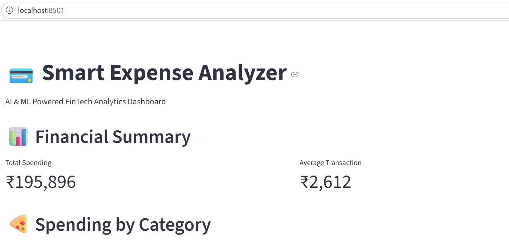
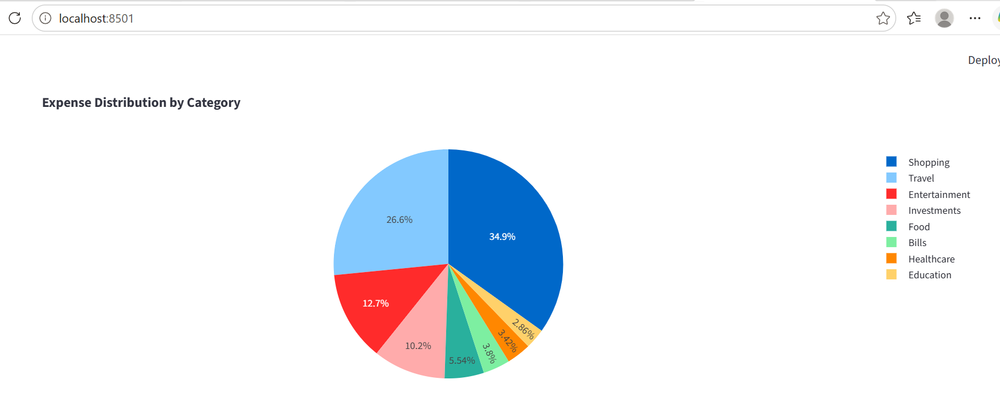
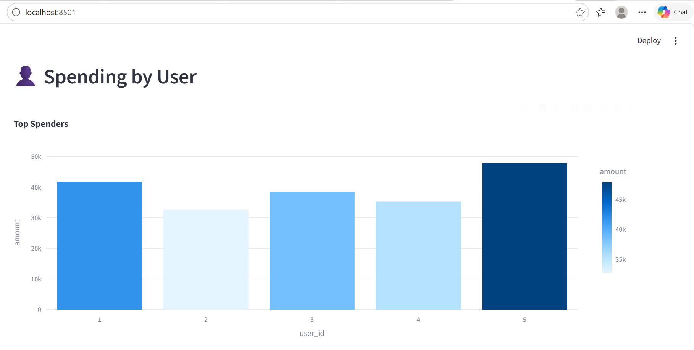
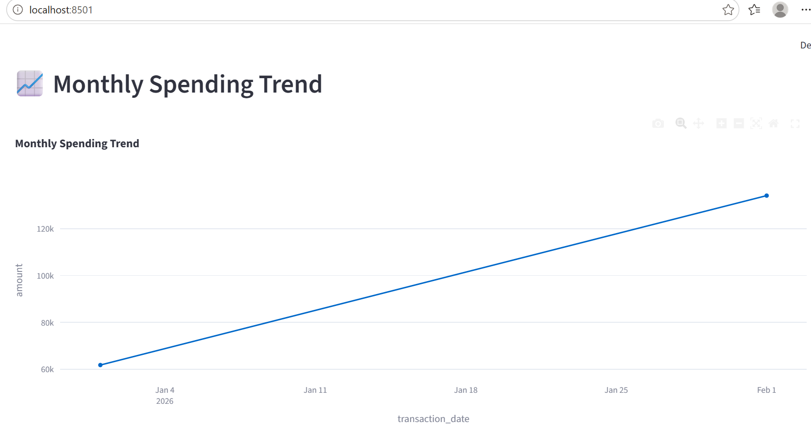
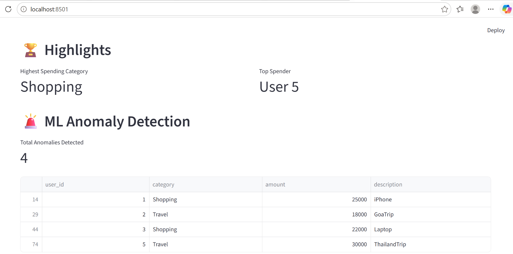
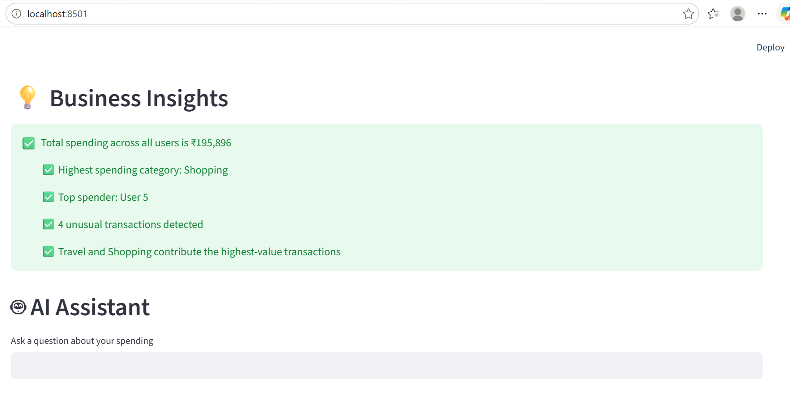

Smart Expense Analyzer
An AI & ML powered FinTech Analytics Dashboard built using Python, Streamlit, Pandas, Plotly, and Scikit-learn.

📌 Project Overview
Smart Expense Analyzer helps users analyze spending patterns, identify high-spending categories, detect unusual transactions, and generate financial insights through an interactive dashboard.
Features
📊 Financial Analytics
Total Spending Analysis
Average Transaction Analysis
Spending by Category
Spending by User
Monthly Spending Trends
🤖 Machine Learning
Isolation Forest Anomaly Detection
Detection of unusual financial transactions
Fraud-risk style transaction monitoring
💡 Business Insights
Highest Spending Category
Top Spender Identification
Spending Trend Insights
🧠 AI Assistant
Users can ask questions such as:

Who spent the most?
What is the highest spending category?
How many anomalies were detected?
What is the total spending?
🏗️ Project Architecture
Transactions CSV
↓
Pandas Data Processing
↓
Analytics Engine
↓
Machine Learning
(Isolation Forest)
↓
Streamlit Dashboard
↓
AI Assistant
🛠️ Tech Stack
Programming Language
Python
Libraries
Pandas
Streamlit
Plotly
Scikit-learn
Database
SQL Server
SSMS
Tools
VS Code
Git
GitHub
📂 Project Structure
Fintech_project
│
├── backend
│ ├── analytics.py
│ └── load_data.py
│
├── frontend
│ └── dashboard.py
│
├── ML
│ └── anomaly_detection.py
│
├── data
│ ├── users.csv
│ └── transactions.csv
│
├── database
│ └── database_schema.sql
│
├── README.md
├── requirements.txt
└── .gitignore
📈 Machine Learning
Isolation Forest is used to identify unusual transactions such as:

iPhone Purchase (₹25,000)
Laptop Purchase (₹22,000)
Goa Trip (₹18,000)
Thailand Trip (₹30,000)
▶️ Run the Dashboard
streamlit run frontend/dashboard.py
Open:

http://localhost:8501
🔮 Future Enhancements
Claude API Integration
Natural Language to SQL
Fraud Prediction Models
Budget Recommendations
Expense Forecasting

